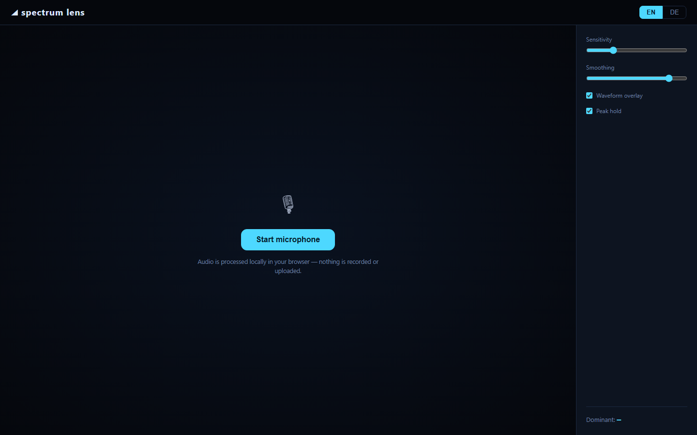
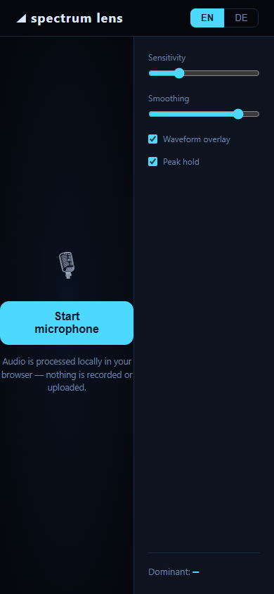

# Spectrum Lens — Real-Time Audio Analyzer

See sound. A real-time microphone spectrum analyzer with frequency bars, oscilloscope waveform, peak hold and musical note detection — all rendered on canvas.

<div align="center">


**[Live Demo](https://ruslanfridenli.github.io/spectrum-lens/)** · **[Deutsch ↓](#-deutsch)**

</div>

---

## Screenshots






## Features

- Live FFT spectrum bars with logarithmic frequency scale
- Oscilloscope waveform overlay
- Peak-hold markers showing recent loudest frequencies
- Musical note names for dominant frequencies
- Sensitivity and smoothing controls
- Works entirely in-browser — no uploads

## Local development

```bash
git clone https://github.com/ruslanfridenli/spectrum-lens.git
cd spectrum-lens
# open index.html in a browser, or serve statically:
npx serve .
```

No build step, no dependencies — pure static site.

---

## 🇩🇪 Deutsch

### Spectrum Lens — Echtzeit-Audioanalyse

Klang sichtbar machen. Ein Echtzeit-Mikrofon-Spektrumanalysator mit Frequenzbalken, Oszilloskop-Wellenform, Peak-Hold und Musiknotenerkennung — alles auf Canvas gerendert.

### Funktionen

- Live-FFT-Spektrumbalken mit logarithmischer Frequenzskala
- Oszilloskop-Wellenform als Overlay
- Peak-Hold-Markierungen der lautesten Frequenzen
- Musiknotennamen für dominante Frequenzen
- Regler für Empfindlichkeit und Glättung
- Läuft komplett im Browser — keine Uploads

### Lokale Entwicklung

```bash
git clone https://github.com/ruslanfridenli/spectrum-lens.git
cd spectrum-lens
npx serve .
```

Reine statische Seite — kein Build-Schritt, keine Abhängigkeiten.

---

Made with care. Feedback welcome via issues.
